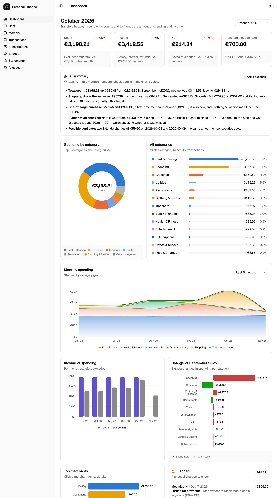
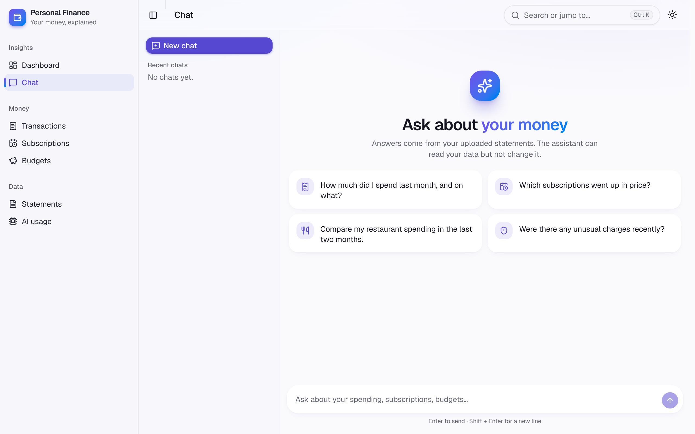
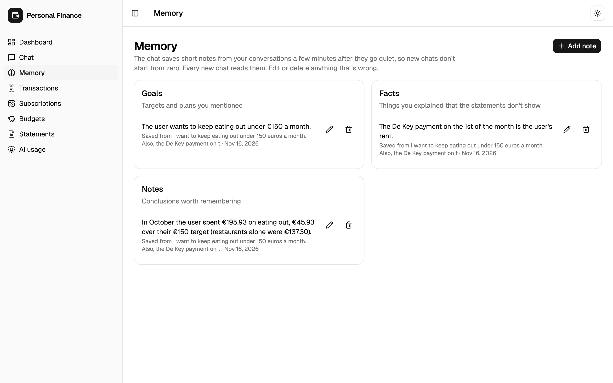
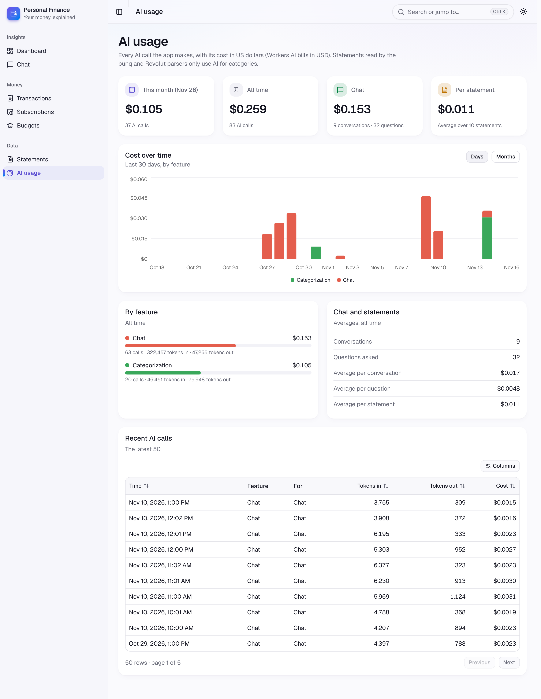

# Personal Finance App

A personal finance app that analyzes bank statements and produces insights. It's under construction.

## Stack

Everything runs in a single [Cloudflare Worker](https://developers.cloudflare.com/workers/), scaffolded from Cloudflare's [`vite-react-template`](https://github.com/cloudflare/templates/tree/main/vite-react-template):

- **API:** [Hono](https://hono.dev/) (`src/worker/`)
- **Frontend:** React + Vite single-page app (`src/react-app/`) built with [shadcn/ui](https://ui.shadcn.com/) (Tailwind CSS v4, Radix), [shadcn Charts](https://ui.shadcn.com/charts) (Recharts) and [TanStack Table](https://tanstack.com/table)
- **D1** (`DB`): SQL database for transactions and analysis results
- **R2** (`STATEMENTS`): storage for uploaded bank statements
- **Workers AI** (`AI`): one multimodal model, [`@cf/deepseek-ai/deepseek-v4.1-flash-1017`](https://developers.cloudflare.com/workers-ai/models/deepseek-v4.1-flash-1017/), reads scanned pages, extracts transactions and categorizes them. It requires the Workers Paid plan.

The deployed app is served only on a custom domain behind Cloudflare Access. `workers.dev` and preview URLs are turned off.

## How statement processing works

**bunq and Revolut statements are read without AI.** A deterministic parser in `src/worker/parsers/` takes the PDF's positioned text (unpdf). It reads the columns in code and validates the result:
- the number of dated rows matches the number of parsed transactions;
- for bunq, money in and money out match the statement's own totals;
- for Revolut, every row's running balance follows from the one before;
- opening balance plus all transactions equals closing balance, to the cent.

If validation fails, or the bank isn't supported, the AI extraction below is used, and the statement records which path was taken (`extraction_method`). AI is then only used to categorize merchants it hasn't seen before. Merchants keep the category they already have. To add a bank, implement `BankParser` (`detect()` and `parse()`) and register it in `src/worker/parsers/index.ts`.

The steps below are the AI path.

1. **Upload** (`POST /api/statements`, multipart): the browser checks the PDF with [pdf.js](https://mozilla.github.io/pdf.js/). If it has no text layer (a scan), the browser renders up to 10 pages to JPEG and sends them along. The PDF goes to R2 at `statements/{id}.pdf`, a row goes into D1, and a [Workflow](https://developers.cloudflare.com/workflows/) instance starts.
2. **Text**: [`env.AI.toMarkdown()`](https://developers.cloudflare.com/workers-ai/features/markdown-conversion/) extracts the PDF text. It isn't an AI model and is free for PDFs. For scans, the model transcribes each page image instead.
3. **Extraction**: the text is split into ~8k-character chunks that the model processes in parallel with a JSON schema (`response_format`). A separate call reads the header: bank, account, period and balances. Output is validated with zod. Signs are corrected from the running balance where the statement prints one. A chunk that returns fewer rows than the text clearly contains is retried with more reasoning effort.
4. **Categories**: each unique counterparty is categorized once, in a separate call, from a fixed list (see `src/shared/categories.ts`).
5. **Checks and storage**: if the statement shows opening and closing balances, the transactions must add up; otherwise the statement gets a warning. Transactions are inserted with a `dedupe_hash` (account, date, amount, occurrence), so re-uploading overlapping statements doesn't double-count.

Statements API: `GET /api/statements`, `GET /api/statements/:id` (with transactions), `DELETE /api/statements/:id`. Overlapping statements are fine. Each statement is linked to all of its transactions (`statement_transactions`). Deleting one only removes transactions that no other statement contains.

## Insights

- **Dashboard** (`GET /api/dashboard?period=YYYY-MM|all`):
  - Spent, income and net, compared with the previous month.
  - Spending by category, as a donut and a full list.
  - Change vs last month per category.
  - Monthly trend and income vs spending.
  - Top merchants and flagged charges.
  - Transfers (between own accounts, to and from friends) are never counted as spending or income.
- **Transactions** (`GET /api/transactions`):
  - Search, plus filters by month, category, merchant (multi-select), recurring and flagged. Filters are kept in the URL.
  - Changing a category applies to one transaction or to the whole merchant. A merchant-wide change is remembered for future uploads (`merchant_overrides`).
- **Merchants:** variants of a name are grouped under one merchant ("AH", "AH to go 5812" and "Albert Heijn" all become Albert Heijn). Merchants can be renamed or merged, and a name variant can be split off again. These choices are stored in `merchant_aliases` and `merchant_variant_rules` and applied when data is read, so future uploads follow them. Each merchant page shows its totals, spending per month, name variants and transactions.
- **Subscriptions:**
  - **Marking:** you mark a payment as monthly recurring. Future charges from the same merchant within 10% of the previous charge match automatically.
  - **Warnings:** the page warns when the price goes up or a charge is overdue.
  - **Suggestions:** merchants charged a similar amount in 3+ months are suggested, and only marked once you confirm.
- **Budgets:** a monthly budget per category, plus an overall one, compared with each completed month.
- **Unusual charges** (`src/worker/lib/analytics.ts`, `FLAG_RULES`). A flag can be dismissed.
  - More than 2.5× the merchant's median earlier charge, with at least 3 earlier charges and at least €20.
  - A first payment to a merchant of €250 or more, once there is 30 days of history.
  - The same merchant and amount within 2 days, for amounts of €10 or more.
  - A recurring charge that went up.
  - Bank fees.

## Chat

The **Chat** page answers questions about your money ("How much did I spend at Albert Heijn in October?", "Which subscriptions went up?"). It uses Cloudflare's Agents SDK:

- **One `ChatAgent` Durable Object per conversation** (`src/worker/chat/agent.ts`, an `AIChatAgent`). Messages are stored in its SQLite and stream to the browser over a WebSocket at `/agents/chat-agent/<conversation id>` (behind Access like the rest of the app). The `conversations` table in D1 lists them; chats can be renamed and deleted.
- **HTTP fallback.** Some networks (corporate web filters such as Zscaler) block WebSockets: the socket never connects or is cut, and the question never reaches the Worker. If the socket doesn't open within 5 seconds or drops before an answer arrives, the page switches to `POST /agents/chat-agent/<id>/http-chat`, answered as a server-sent event stream (AI SDK `DefaultChatTransport`), resends the unsent question, and uses HTTP straight away for the next 24 hours. Both paths read and write the same saved conversation (`src/react-app/lib/chat-connection.tsx`, `ChatAgent.onRequest`). Errors are shown with a Retry button.
- **The model answers by calling the read-only finance tools** listed under "MCP server" below. Under each answer, "Used …" expands to show the tool calls and their results. The model can't change data.
- **Model:** DeepSeek V4.1 Flash with low reasoning (`CHAT_MODEL` in `src/worker/chat/core.ts`). `npm run eval:chat` checks tool calling on 16 questions against the synthetic data (real Workers AI, about $0.01 per run); pass `EVAL_MODELS="@cf/a,@cf/b"` to compare models.

## Memory, monthly summaries and the cache

- **Highlights (Memory page).** Five minutes after a conversation goes quiet, the chat agent sends the new messages and the existing notes to the AI, which returns at most a few short notes: goals ("keep eating out under €150 a month"), facts the statements can't show ("the De Key payment on the 1st is rent"), answer preferences, and conclusions worth recalling. Notes that repeat an existing one are skipped or update it. They are stored in the `memories` table, and every new question starts with all goals and preferences plus the latest notes (30 at most). The Memory page lists them by kind; you can add, edit and delete notes. Vectorize isn't used: at this size all notes fit in the prompt. If notes grow into the hundreds, semantic lookup with Vectorize would be the next step.
- **Monthly summaries.** After a statement is processed, the Workflow computes facts for each month it covers (totals, change vs the previous month, biggest category changes, new merchants, subscription warnings, unusual charges) and the AI writes 3–5 bullets from them (`digests` table). The dashboard shows them as the "AI summary" card. A summary is only rewritten when its month's facts change (for example after a category change), and then in the background when the dashboard asks for it. The chat starts with the latest month's summary and can read others with the `get_digest` tool (also on MCP).
- **Tool cache.** Tool results are cached by tool and arguments in `tool_cache`, valid for the current `data_version`. Any change to the data (an upload, a delete, a category, merchant, recurring, budget or flag change) bumps `data_version` and clears the cache, so answers never use old numbers. Every tool call is logged in `tool_calls`; the AI usage page shows the hit rate for the chat and the MCP server.

## AI usage

Every Workers AI call (statement reading, categorization, chat, highlights, monthly summaries) is stored in the `ai_usage` table with its tokens and cost. The **AI usage** page (`GET /api/usage`) shows this month's and all-time cost, cost per day or month by feature, chat conversations and questions, and averages per conversation and per statement. There is no spending cap. Prices per model live in `PRICING` in `src/worker/lib/usage.ts`.

## MCP server

`/mcp` is a stateless [MCP](https://modelcontextprotocol.io) server (Streamable HTTP, built with Cloudflare's Agents SDK `createMcpHandler`). It exposes the same read-only tools the in-app chat uses (`src/worker/lib/tools.ts`):

| Tool | What it returns |
|---|---|
| `get_overview` | Totals for a month or period, change vs the previous month, top categories and merchants, months with data |
| `search_transactions` | Matching transactions by merchant, category, period, amount or text, with totals |
| `spending_by_category` | Spending per category with shares |
| `compare_periods` | Two months compared per category or merchant |
| `merchant_detail` | One merchant's totals, monthly spending, recurring status and latest transactions |
| `subscriptions` | Recurring payments, monthly and yearly totals, price-increase and missed-charge warnings |
| `budget_status` | Budgets vs spending for a month |
| `unusual_charges` | Flagged charges and why |
| `get_digest` | A month's AI summary and the facts it was written from |

The tools run fixed queries; the model never writes SQL. Check them locally with `node scripts/mcp-check.mjs` while `npm run dev` runs.

**Access.** `/mcp` is on finance.novojitsaha.com, so the Cloudflare Access application protects it like the rest of the app: a browser session works, an AI client without one gets the Access login page. To connect an external client (Claude, ChatGPT, an IDE) later, choose one of:

- **Cloudflare Access as the OAuth server (recommended):** Cloudflare Access can secure MCP servers for remote clients, so the client signs in with your identity provider through Access. Check the current Zero Trust docs for MCP server applications when setting this up; it should need no code change.
- **Service token:** for a client that can send custom headers, create an Access service token and add a Service Auth policy; the client sends `CF-Access-Client-Id` and `CF-Access-Client-Secret`.
- **OAuth in the Worker:** wrap the handler with `@cloudflare/workers-oauth-provider` and pass the user via `authContext` (see Cloudflare's "Build a remote MCP server" guide).

Remember that a connected AI provider receives the data its tool calls return.

## Development

```bash
npm install
npm run db:migrate:local
npm run seed:local   # optional: six months of made-up data (wipes the local database)
npm run dev
```

The app runs at http://localhost:5173. Local D1, R2 and Workflow state is kept in `.wrangler/`. Workers AI has no local simulation, so `npm run dev` calls the real models on your Cloudflare account. They're billed like production use, beyond the free daily allocation.

## Tests

```bash
npm test            # unit tests (Vitest)
npm run typecheck
npm run fixtures    # regenerate the synthetic statements in test-fixtures/
npm run test:e2e    # with `npm run dev` running: upload the fixtures and score extraction
npm run test:overlap  # with `npm run dev` running: overlapping statements, both upload orders, deletes
```

`test-fixtures/` contains made-up statements in different layouts (ING-, Revolut- and Bunq-like, plus an image-only "scanned" one) with their ground truth in `test-fixtures/expected/`. Never commit real bank statements; `.gitignore` blocks PDFs outside `test-fixtures/`.

After changing `wrangler.jsonc`, regenerate binding types:

```bash
npm run cf-typegen
```

## Deploy

```bash
npm run deploy
```

Apply new D1 migrations first with `npm run db:migrate:remote`. Deploying builds the app and deploys it with Wrangler. You need to be logged in (`npx wrangler login`) to the Cloudflare account that owns the D1 database and R2 bucket in `wrangler.jsonc`.

## Screenshots

Taken with the synthetic data from `npm run seed:local`.









## License

[MIT](LICENSE)
